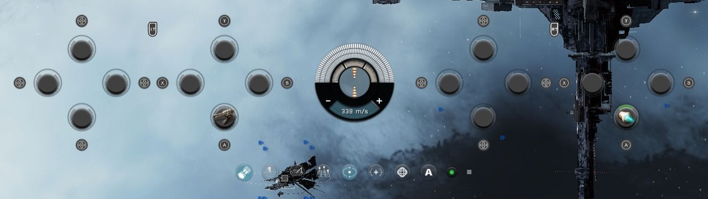
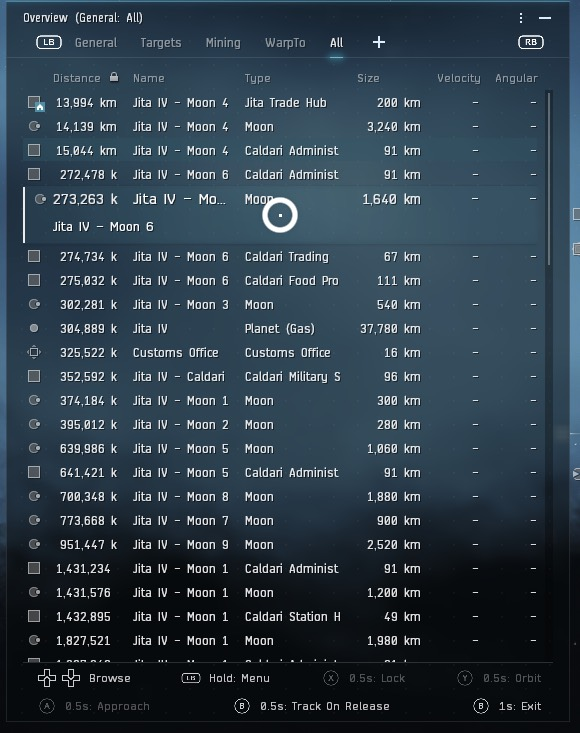

<p align="center">
  
</p>

<h1 align="center">EveJS Controller Support</h1>

<p align="center">
  Universal controller support for EveJS, with precision cursor control, camera navigation, and automatic input switching.
</p>

<p align="center">
  
  
  
</p>

<p align="center">
  <a href="https://discord.gg/qxgMmtGmb7"></a>
  <a href="https://github.com/cfin3d/EveJS-Controller-Support/issues/new/choose"></a>
  <a href="CHANGELOG.md"></a>
</p>

<p align="center">
  <a href="#features">Features</a> ·
  <a href="#compatibility">Compatibility</a> ·
  <a href="#installation">Installation</a> ·
  <a href="#usage">Usage</a> ·
  <a href="#controls">Controls</a> ·
  <a href="#configuration">Configuration</a> ·
  <a href="#support">Support</a>
</p>

---

> [!NOTE]
> **Unreleased Testing Build.** The first release will be **1.0.0**.

## Features

- **Precision Cursor Control:** finer movement with smooth acceleration everywhere, plus attraction to UI controls and context-menu items.
- **Click Confirmation:** circular progress feedback with support for dragging.
- **Camera and Ship Navigation:** pan, zoom, fly toward camera center, and stop.
- **Controller Settings:** select a device, customize bindings, and save profiles in EVE's settings menu.
- **Native Overview Navigation:** focus the original Overview, browse enlarged rows, switch tabs, and use native object menus.
- **Controller Families:** PlayStation and Steam input paths, with automatic white button icons and a manual style override.
- **Combat Feedback:** distinct damage vibrations and ship-destruction feedback, with adjustable strength and optional detailed DualSense USB haptics.
- **Automatic Input Switching:** move freely between controller and mouse/keyboard controls.
- **In-Game Runtime:** starts at login; no separate application or tray icon.

## Compatibility

| Requirement | Supported Configuration |
| :--- | :--- |
| EveJS | **0.12.9** |
| EveJS Launcher | **1.0.53+**; launcher integration verified with **1.0.72** |
| EVE Client | **Build 3396210**, Windows x64 |
| Controller Input | Xbox-compatible devices, DualShock/DualSense, and Steam controller input paths |
| SteamOS / Proton | Experimental; requires running the Windows client and launcher through a compatible setup |
| Server Backend | Native or Docker |

Launcher **1.0.72** supports both separate and shared EVE settings with this mod. Controller preferences and saved controller profiles remain in the mod folder and apply across accounts using that installation.

PlayStation/Steam hardware and SteamOS/Proton compatibility need community testing. The bundled controller library has been checked with simulated devices; physical-device coverage is not yet verified.

<details>
<summary><strong>Controller Connections and Icons</strong></summary>

- **PlayStation:** direct USB/Bluetooth input paths are included. Detected PlayStation devices use matching white symbols and L1/R1/L2/R2 labels in settings and radial prompts.
- **Steam Deck / Steam Controller:** use gamepad output when launching through Steam Input. On controllers using a trackpad for right-stick functions, map that trackpad to the right joystick in the Steam controller layout.
- **Button Icons:** **Auto-Detect** follows the active detected controller. Steam Input and other mappers may expose a virtual Xbox device; choose **PlayStation 4**, **PlayStation 5**, or **Steam** manually in **Settings → Controller** when needed.
- **Multiple Controllers:** Auto-Detect follows controller activity. Use **Identify Controller** or choose a named slot to keep one device selected. Up to 16 connected slots are available; identify it again if connection order changes between sessions.
- **Extra Inputs:** independently exposed rear buttons and touchpad clicks can be captured in custom bindings. Inputs mapped to ordinary buttons share those bindings. Motion controls, touch gestures, and adaptive-trigger resistance are not implemented.
- **Feedback:** report the controller model, USB/Bluetooth/Steam Input connection, operating system/Proton version, detected device name, and affected action in [Issues](https://github.com/cfin3d/EveJS-Controller-Support/issues).

</details>

## Installation

1. **Download:** select **Code → Download ZIP**, then extract it.
2. **Prepare:** rename the extracted folder to **`evejs-controller`**.
3. **Install:** drag the folder into your EveJS installation's **Mods** folder.
4. **Enable:** refresh **Mods** in the launcher and enable **EveJS Controller**. Adopt the package if prompted.
5. **Launch:** restart the server when requested, then log in through EveJS Launcher.

<details>
<summary><strong>Folder Layout</strong></summary>

The manifest belongs directly inside the mod folder:

```text
mods/
└── evejs-controller/
    ├── evejs-launcher.mod.json
    └── …
```

</details>

<details>
<summary><strong>Release Downloads and Updates</strong></summary>

- **Release Downloads:** when available, download a ZIP from [Releases](https://github.com/cfin3d/EveJS-Controller-Support/releases). Extract it and drag the enclosed `evejs-controller` folder into Mods, then follow steps 4–5 above.
- **Updates:** close EVE and back up `preferences.json`. Replace the mod folder, restore compatible settings according to the changelog, refresh Mods, and restart/log in when requested.

</details>

## Usage

| Mode | How to Activate |
| :--- | :--- |
| **Controller Mode** | Use a controller input. |
| **Mouse/Keyboard Mode** | Move, click, or scroll the mouse, or use the keyboard. |

Switching is automatic by default. Mouse/keyboard input cancels unfinished controller holds and restores the normal pointer. Enable **Lock Controller Mode** in **Settings → Controller** or the launcher to stay in controller mode during mouse/keyboard use. With the lock on, physical input cannot switch modes, release controller navigation focus or interrupt controller holds and queued actions. The lock applies while EVE is focused and a controller is connected.

<details>
<summary><strong>Combat HUD</strong></summary>

The overhauled HUD is included in controller mode with no separate toggle. It starts with sixteen empty fixed slots; drag modules from the live fitting window onto them, move shortcuts between slots, or drag them onto empty space to clear them. Assignments are remembered for each individual ship. Removing a shortcut leaves the module fitted.

For assigned active modules, tap the trigger/button combination to cycle **Activate → Deactivate → Offline → Online → Repeat**. Short taps act on release without waiting for the overload timer or bank animation. Each step follows the module's actual state; wait for deactivation to finish before the offline step. Native offline confirmations and online requirements remain in effect, including weapon-group warnings. A canceled or failed transition stays on the same step. Hold the combination for one second to toggle overload without advancing the tap cycle.

The controller cursor retains native module tooltips and right-click menus. Native menus take priority over module gestures; both triggers held together suppress direct module actions. Existing camera zoom and bumper clicks remain available. Input takeover, ship changes and HUD rebuilds resynchronize the tap cycle from the module's current state; passive modules retain their native cursor controls.

Holding LT or RT smoothly enlarges that bank by 5% and dims the opposite bank to 60% opacity over 160 ms. Release restores both banks. Fixed button prompts use matching white artwork and opaque dark backings: circular badges for module buttons and shaped backings for the triggers.

The banks and native gauge share one center axis. A centered utility strip includes cargo, scanners, tactical overlay, all three camera controls, autopilot, safety and HUD options, plus the Mining Surveyor, native zoom and weapon-group controls when available. The stock module rack stays hidden while the controller HUD is active. Undocking and native HUD rebuilds restore and reattach controls; a HUD error falls back without stopping normal controller input.

EVE applies UI scaling to the native controls. Layout uses the resulting **logical UI size**, so a higher scale leaves less space even at the same screen resolution. Module sizes and assignments stay unchanged between layouts.

| Usable UI Size | Layout |
| :--- | :--- |
| At Least 1,280 × 356 Logical Pixels | Wide banks beside the gauge. |
| Otherwise, At Least 768 × 616 Logical Pixels | Compact banks with each bank's two diamonds stacked vertically. |
| Neither Layout Fits | Original HUD; normal controller input remains available. |

The complete HUD follows EVE's camera and saved HUD offsets, including top/bottom alignment. Near the screen edges, the assembly is kept inside the viewport with an eight-pixel logical margin. The camera offset and native HUD preferences are preserved. Resolution and UI-scale changes re-evaluate the layout automatically; changing layouts cancels pending module presses without changing assignments.

Module assignment is supported in space; docked fitting integration remains in development. Automatic switching to mouse/keyboard restores the original HUD. With **Lock Controller Mode** enabled, the controller layout remains visible during mouse/keyboard use. Disconnection, loss of game focus or disabling the mod restores native presentation.

</details>



### Controls

| Control | Action |
| :--- | :--- |
|  **Left Stick** | Move the cursor. Small movements are precise; full deflection is fast. |
|  **Left Bumper** | Hold **0.5 seconds** for right-click. Its context menu starts controller navigation automatically. |
|  **Right Bumper** | Hold **0.5 seconds** over a target to open its radial menu. On normal UI, hold for left-click and continue holding to drag. |
|  **Select / View** | Open controller navigation in the Neocom menu. |
|  **Start / Menu** | Focus the existing Overview and move to its first listed object. |
|  **B — Hold, Then Release** | Move to the focused window's X; release after **one second** to close it. Release early to cancel and return the cursor. |
|  **Right Stick** | Scroll the focused window, pan a focused Map/Ship Tree, or pan/rotate the camera when no menu is focused. |
|   **Hold Left Trigger + Right Stick** | Move **up** to zoom in or **down** to zoom out. Release the trigger to resume panning. |
|  **Right Stick — Short Press** | Release before one second to fly toward camera center. |
|  **Right Stick — Hold** | Hold **one second** to request stop. |

These are the default bindings. Release a bumper early to cancel its click. A long right-stick hold stops the ship without first issuing flight.

### Overview Navigation

Overview's bumper prompts and footer stay visible throughout controller mode, including before navigation starts and after it ends. The idle footer shows **Focus Overview** and dims navigation actions. Press **Start / Menu** to focus an open Overview. The cursor moves to the first object in the current tab, marked by a thin white bar. Browsing keeps EVE's native columns, transparency, standing colors, filters, and object icons. The footer shows the current controls in wrapping rows, dims unavailable actions, and becomes compact when an object menu is open.



| Control While Focused | Action |
| :--- | :--- |
|   **D-Pad Up / Down** | Browse objects immediately; hold to repeat and scroll the list. |
|   **Tap LB / RB** | Switch to the previous / next native tab on release. |
|  **Hold LB** | Open the focused object's native context menu. |
|  **Hold RB In The Context Menu** | Confirm its highlighted action. The menu closes and Overview navigation resumes on the same object. |
|  **Hold B For 1 Second** | Exit Overview focus and return to the original cursor position without tracking. Inside a context menu, B closes that menu first using the normal menu hold. |
|  **Hold X For 0.5 Seconds** | Lock the focused object when EVE allows it. Does not toggle an existing lock off. |
|  **Hold Y For 0.5 Seconds** | Orbit the focused object at EVE's current default range. |
|  **Hold A For 0.5 Seconds** | Approach the focused object. |
|  **Hold B For 0.5 Seconds, Then Release Before 1 Second** | Track the focused object with the camera. Continuing to one second exits instead. |

Move the **cursor stick** (left stick by default) to browse freely inside Overview. Move outside its window to release focus at the cursor's current position; D-pad input resumes row navigation. Leaving an object menu releases both menu and Overview focus. Hold B for one second returns to the original cursor position.

The focused row smoothly grows, pushing neighboring rows apart. Columns stay aligned on one line. When a name exceeds its native column width, show it with an ellipsis above a smaller detail line spanning the available row width. Details use at most two lines when space allows; hover either name for the complete text. Native column widths and the configured row height stay unchanged. Grey face-action prompts mean EVE's native menu does not currently offer that action for the focused object; availability follows the object, distance and current game state. **Click / Activation Hold** controls bumper/menu holds. Overview face actions use fixed 0.5-second holds, with a separate one-second B exit. Release early to cancel; moving to another object or moving the cursor cancels the pending action and requires a fresh press. Each hold activates once. Browsing alone does not click an object or change the selected target.

<details>
<summary><strong>Overview Customization And Focus</strong></summary>

- Rebind **Focus Overview** under **Settings → Controller → Bindings**. Existing Start/Menu assignments and combinations are preserved on update.
- Set **Focused Row Extra Height** under **Settings → Controller → Overview**; zero retains native row and text sizes. Disable **Smooth Overview Transitions** for immediate movement.
- Camera pan/zoom works immediately after login and after exiting Overview focus, even if EVE still marks Overview or a window without scrolling as active. Other focused scrollable windows, menus and dialogs retain their normal navigation.
- The enabled combat HUD stays visible during Overview and object-menu navigation. Module controls pause until Overview focus ends; existing module activity continues.
- Native tab order, renamed tabs, filters, column widths, window placement, fonts and UI scaling remain under EVE's control. With multiple open Overviews, the hovered Overview takes priority, followed by the last used visible Overview.
- Focus follows an object's identity through sorting. If it disappears, pending holds are canceled; use fresh D-pad input to choose another object.
- Mouse/keyboard takeover, window closure, session changes and native modal dialogs cancel Overview focus and restore row sizes. Held buttons and triggers must be released before ordinary actions resume.
- With automatic switching, mouse/keyboard takeover restores the original Overview presentation. **Lock Controller Mode** preserves its controller presentation, navigation focus and holds during mouse/keyboard use. Controller focus-exit controls remain available.

</details>

### Right-Click Context Menus

Open a context menu with **LB**. The cursor moves smoothly to its first enabled item and stays within the active menu panel.

| Control While Open | Action |
| :--- | :--- |
|   **D-Pad Up / Down** | Move between enabled items immediately; hold to repeat. |
|  **D-Pad Right** | Enter a submenu. |
|  **D-Pad Left** | Return to the parent menu and its previous item. |
|  **Hold RB** | Select the highlighted action, or enter a submenu-only item. Overview object menus resume Overview navigation; other menus restore normal cursor use. |
|  **Hold B** | Close the whole context menu and return the cursor smoothly to where it opened. |

**RB/B holds default to 0.5 seconds**, using **Click / Activation Hold** in **Settings → Controller**. Release early to cancel a hold; changing items restarts RB's timer. The cursor stick moves freely inside the menu and its open submenus; moving outside closes the menu and releases focus without returning the cursor. D-pad input resumes row navigation. Camera and other gameplay bindings pause during navigation. With automatic switching, physical mouse/keyboard activity hands the native menu back to mouse control. **Lock Controller Mode** retains controller ownership and hold progress. Menus opened with a physical mouse keep their normal behavior.

### Focused Window Navigation

- **Right Stick Up/Down:** scroll the focused window's list or scrollbar. Move left/right for a pane with a horizontal scrollbar. No activation hold is required.
- **Map / Ship Tree:** pan in all directions. Hold **LT + Right Stick Up/Down** to zoom the focused view; Ship Tree retains its native two zoom levels.
- **Multiple Panes:** the pane under the cursor takes priority within the focused window, followed by keyboard focus and the last used pane. The cursor stays where it is.
- **Priority:** Neocom, controller context menus and radial controls retain their own navigation. Dragging and input detection pause scrolling. A focused menu owns the stick even at a scroll boundary; camera-center flight and stop stay inactive until focus returns to the game view.

Adjust **Pan / Scroll Speed** in **Settings → Controller → General → Camera**. Existing camera-pan and zoom bindings apply to focused UI navigation as well. Camera inversion affects the game camera; UI scrolling keeps its normal direction.

### Close Focused Windows

With a window such as **Skills**, **Inventory**, **Settings**, **Ship Tree**, or **Map** focused, hold **B**. The cursor moves smoothly to its X and fills the hold indicator. **Release after the indicator fills** to use that X. Continuing to hold keeps the window open.

| Result | Cursor Position |
| :--- | :--- |
| **Released Before the Timer Fills** | Returns smoothly to its starting position; the window stays open. |
| **Released After the Timer Fills** | Uses the native X action once; stays where the X was after successful closure. |
| **Interrupted or No Longer Closable** | Cancels the action and restores the starting position. |

Set **Window Close Hold** in **Settings → Controller → General → Hold Timing**; it defaults to **1,000 ms**. Rebind **Close Focused Window** under **Bindings**. Neocom and context-menu RB/B holds use **Click / Activation Hold**, and radial B cancellation stays immediate.

<details>
<summary><strong>Window Focus, Cancellation, and Existing Bindings</strong></summary>

- Targets the window focused when the hold starts, using its actual visible, enabled X. Modal windows take priority; hidden, covered, blocked, and unclosable controls are excluded. A stack follows its visible X's native close-stack behavior.
- Changing the focused window/tab, moving a stick, pressing another controller input, losing focus/connection, changing sessions/settings, or starting binding capture cancels the hold. Other controller actions pause while it moves, holds, or returns the cursor; release the controls to resume.
- Native X behavior, including close restrictions and confirmation dialogs, is preserved. A rejected close restores the starting position while the gesture still owns the cursor.
- Mouse/keyboard takeover cancels the hold. Losing application focus does not move the desktop pointer; the saved position is restored when EVE has focus and controller input resumes.
- Existing B bindings and combinations are preserved on update. If B was already assigned, **Close Focused Window** starts unassigned until you choose its input. Neocom and radial navigation retain their contextual B actions.

</details>

### Neocom Navigation

Press **Select / View** to open Neocom. D-pad navigation moves the cursor smoothly between items. The cursor stick also moves freely inside Neocom and its open submenus; moving outside closes them and restores normal cursor use at that position. D-pad input resumes item navigation. The enabled combat HUD remains visible while module controls pause.

| Control While Open | Action |
| :--- | :--- |
|   **D-Pad Up / Down** | Move between items immediately; hold to repeat. |
|  **D-Pad Right** | Enter a submenu immediately. |
|  **D-Pad Left** | Return to the parent menu immediately. |
|  **Hold RB** | Fill the indicator to select an item. Groups open their submenu; opening an item collapses Neocom and restores normal cursor use. |
|  **Hold B** | Fill the indicator to close Neocom and restore normal cursor use. |

**RB/B holds default to 0.5 seconds**, configured by **Click / Activation Hold** in **Settings → Controller**. D-pad navigation has no activation hold. Pressing **Select / View** again also closes Neocom. Mouse/keyboard input ends controller navigation; normal gameplay and custom actions pause while it is active.

<details>
<summary><strong>Neocom Bindings and Activation</strong></summary>

- Rebind **Open Neocom** in **Settings → Controller → Bindings**. Existing assignments to Select/View are preserved when updating; if that input was already used, assign Open Neocom yourself.
- Releasing RB or B before its hold completes cancels the pending activation. RB's timer restarts when the highlighted item changes, and each hold activates only once. B takes priority over RB when both are held.
- Native hover expansion pauses during controller navigation, keeping submenu changes under D-pad control. Focus loss, disconnection, session changes, or opening Settings also closes the controller menu.

</details>

### Target Radial Menu

Hold **RB** over a targetable space bracket, overview entry, or locked-target icon until the cyan indicator fills. Windows, empty space, your own ship, and non-targetable objects do not open the controller radial.

| Control While Open | Action |
| :--- | :--- |
|  **Left Stick** | Move the cursor within the wheel to select a wedge. Hold toward **More** to open its additional options. |
|  **D-Pad Up / Down** | Increase / decrease a range action's distance. Keeps that action selected, including after centering the stick. |
|  **Release Right Bumper** | Execute the highlighted action once. Release without a highlighted action to cancel. |
|  **B** | Cancel immediately. |

Normal cursor, click, camera, zoom, flight, and stop controls pause while the wheel is open. Mouse/keyboard activity cancels it. Release the controls after closing to resume normal controller input.

<details>
<summary><strong>Radial Behavior and Bindings</strong></summary>

- Uses EVE's native actions, disabled states, range values, icons, and animations. Available actions depend on the target.
- Beneath **Range**, the prompts show the last highlighted range action and its selected distance. The value updates as you adjust it and remains visible when moving off that action.
- Keeps the original target until closing; target loss, docking, session changes, or opening Settings cancels the wheel.
- **Left-Click / Target Radial** shares one configurable binding and the click hold timer. Existing bindings and preferences are preserved.
- The wheel displays its activation and cancel buttons. If the activation binding includes **B**, the cancel prompt uses a free face button, or left-stick press if necessary.
- If the activation binding uses **D-Pad Up / Down**, the right stick adjusts range vertically instead; its normal camera actions remain paused.
- Centering the left stick clears selection unless a range adjustment is active. D-pad input can restore the last range action on the current level; use **B** to cancel after adjusting a range.

</details>

<details>
<summary><strong>Cursor Feedback</strong></summary>

| Indicator | Meaning |
| :--- | :--- |
| **Cyan Arc** | Left-click, target radial opening, or Neocom RB confirmation. |
| **Amber Arc** | Right-click confirmation, Neocom B cancellation, or focused-window close progress. |
| **Orange Arc** | Stop confirmation. |
| **Center Dot** | Flight direction; hidden beneath menus and when UI covers camera center. |

- **UI Attraction:** move slowly toward a nearby control or context-menu item; strong or sustained outward movement escapes attraction. It pauses while clicking or dragging.
- **White Cursor Ring:** a larger, solid white outline; the camera-center dot keeps its minimal size.
- **Hold Reset:** changing targets or moving more than 10 pixels restarts an unfinished click hold.

</details>

## Configuration

In EVE, open **Settings → Controller**. Changes save and apply automatically.

| Option | Use |
| :--- | :--- |
| **General → Input Device** | Auto-detect or select a controller, identify it, choose button icons and toggle **Lock Controller Mode**. |
| **General → Camera** | Adjust pan/zoom speed and toggle **Invert Camera Pan** for vertical panning. |
| **General → Cursor** | Adjust precision, speed, UI attraction and cursor appearance. |
| **General → Hold Timing** | Adjust click/stop/window-close timing and trigger activation. |
| **General → Vibration** | Enable/disable all feedback, adjust overall and event strengths, toggle damage/destruction effects, and test or stop vibration. |
| **Overview** | Adjust focused-row expansion and toggle smooth transitions on its own page. |
| **Bindings → General Actions** | Rebind or clear actions grouped under **Cursor And Clicks**, **Camera And Flight**, and **Menus And Windows**. Each row shows its function, input and activation behavior. |
| **Bindings → Custom Shortcuts** | Browse or search EVE functions by category, review descriptions and current/default keyboard shortcuts, then capture a controller input and select **Add Binding**. |
| **Bindings → Context Categories** | Browse **Overview**, **Neocom**, **Context Menus**, **Target Radial**, and **Combat Modules** for their fixed controls and functions, including all sixteen module combinations. Shared actions follow your current bindings. |
| **Profiles** | Save, load, or delete named configurations; **Restore Defaults** restores the default controls and feel. |

Use **Settings Page** to choose **General**, **Overview**, **Bindings** or **Profiles**. General groups the basic settings under spaced headings on one scrolling page. Within **Bindings**, use **Binding Category** to choose editable actions, custom shortcuts or a context reference. White icons show combinations with **+** and alternative inputs with **/**. Input activity and **Cancel Input Detection** stay above the scrolling page.

### Vibration Feedback

In **Settings → Controller → General → Vibration**, use **Enable Vibration** as the master toggle. **Test Vibration** previews enabled patterns on the selected controller; **Stop Vibration** ends the preview. No gameplay action is required to test it.

| Event | Feedback |
| :--- | :--- |
| **Laser Damage** | Light, brief buzzing. |
| **Projectile / Hybrid Damage** | Medium, sharp impacts. |
| **Missile Damage** | A heavier, deeper impact with a fading tail. |
| **Other / Unidentified Damage** | A moderate fallback pulse. |
| **Your Ship Explodes** | A strong burst followed by a diminishing rumble. |

Only incoming damage to the ship you are currently piloting activates combat feedback. **Your drones, fighter squadrons, deployables, structures, and other owned objects do not trigger it**, including when they are destroyed. Rapid hits blend with capped intensity; your ship's destruction takes priority. Mouse/keyboard takeover, focus loss, disconnection, disabling the mod, or disabling vibration cancels combat playback. A settings preview also ends when you leave the Controller category or start input detection.

<details>
<summary><strong>Enhanced DualSense Haptics and Testing</strong></summary>

- **Enable:** connect a Sony DualSense or DualSense Edge directly by USB, then enable **Enhanced DualSense Haptics (USB)**. The option is off by default; the detailed output path remains experimental pending physical-device feedback.
- **Detailed Patterns:** independently authored waveforms use the controller's two haptic audio channels. The audible channels remain silent, and the mod does not change your default audio device or route game sound through the controller.
- **Matching:** requires one detected Sony controller and one recognized four-channel controller audio endpoint. Wireless connections, hidden/virtual device identities, ambiguous devices, or unavailable endpoints use standard vibration where supported.
- **Status:** the Vibration label reports the last tested output path, including **Enhanced DualSense Haptics (USB)**, standard fallback, or unavailable vibration. Selecting PlayStation button icons alone does not enable DualSense hardware features.
- **Test:** previews laser, projectile, missile, then destruction patterns when their options are enabled. Strength settings apply to both standard and enhanced output. Turning **Enable Vibration** off stops an active effect immediately in the game settings; external launcher changes apply when the client refreshes its configuration.
- **Coverage:** hardware feel, firmware differences, USB/Bluetooth vibration, and SteamOS/Proton output need community testing. Adaptive-trigger resistance is not included. Share the connection, toggles, strengths, displayed Vibration status, and affected pattern in a [Compatibility Report](https://github.com/cfin3d/EveJS-Controller-Support/issues/new?template=03-controller-compatibility.yml).

</details>

<details>
<summary><strong>Defaults and Binding Capture</strong></summary>

| Setting | Default |
| :--- | :--- |
| Controller | Auto-Detect |
| Lock Controller Mode | Off (Automatic Switching) |
| Stick Deadzone | 20% |
| Maximum Cursor Speed | 1,100 px/s |
| Camera Movement Speed | 800 |
| Camera Zoom Speed | 0.8 |
| Invert Camera Pan | Off |
| Click Hold | 500 ms |
| Right Stick Stop Hold | 1,000 ms |
| Window Close Hold | 1,000 ms |
| Vibration | On |
| Overall / Damage / Destruction Strength | 65% / 80% / 100% |
| Enhanced DualSense Haptics | Off |
| Circular Cursor | On |
| UI Attraction | On |

- **Capture:** select the binding, release controls, then press buttons or move a stick. Hold modifiers while moving the stick; release a button combination to finish recording it.
- **Cancel:** select **Cancel Input Detection**, press Esc, or wait 15 seconds.
- **Tap/Hold:** flight occurs on release; stop uses the configured hold time. They can share one binding.
- **Rear Buttons and Touchpad Clicks:** capture independently exposed inputs as custom bindings. Buttons mapped to existing inputs share those bindings.
- **Launcher:** basic feel settings remain available under **Mods → EveJS Controller → Configure** and use the same configuration file.

</details>

<details>
<summary><strong>Custom Shortcuts and Conflicts</strong></summary>

- **EVE Action:** select an **Action Category**, search functions/descriptions, and choose an **EVE Function**. The list comes from the running client's native command catalog, including functions without keyboard assignments. Review its description and **Current Shortcut / Default Shortcut**, choose a controller input or combination, then select **Add Binding**.
- Native categories include **Window**, **Combat**, **General**, **Navigation**, **Modules**, **Drones**, **Fighters**, and **Character Creation**. The client supplies localized names and available detailed descriptions, with concise explanations for common actions where EVE provides no longer description. **Refresh** rereads the catalog and current keyboard assignments.
- Action bindings follow the selected EVE function even if its keyboard shortcut changes or is unassigned. They do not modify EVE's keyboard shortcuts.
- **Keyboard Shortcut (Advanced):** the original modifier/key editor remains available. It resolves shortcuts configured in **Settings → Shortcuts** and retains the original function identity; configure an unassigned keyboard shortcut there first. Existing saved shortcut bindings retain this behavior.
- Custom actions run once per controller press through EVE's native command dispatcher. They pause in Settings, during input capture, and while the controller radial is open.
- Selecting an existing custom row opens it for editing; **Remove** deletes it. Custom bindings are included in saved profiles.
- **Replace Binding** removes the conflicting controller assignments and saves the new one. **Cancel** leaves the existing configuration intact.
- A replacement can disable a core controller action. The dialog names affected actions and explains when replacing left-click requires mouse/keyboard to configure a replacement.
- Supports up to **32 custom bindings** across both methods. Missing or unavailable functions do not execute, and a changed keyboard assignment cannot redirect an existing binding to a different function.

</details>

## Support

Use the [Reporting Guidelines](https://github.com/cfin3d/EveJS-Controller-Support/blob/main/.github/REPORTING.md) for examples and help finding setup details. Unknown details are welcome; screenshots and logs are optional.

| Feedback | Where to Go |
| :--- | :--- |
| **Bugs** | [Report a Problem](https://github.com/cfin3d/EveJS-Controller-Support/issues/new?template=01-bug-report.yml) |
| **Suggestions** | [Request a Feature](https://github.com/cfin3d/EveJS-Controller-Support/issues/new?template=02-feature-request.yml) |
| **Tested Hardware** | [Share Controller Compatibility](https://github.com/cfin3d/EveJS-Controller-Support/issues/new?template=03-controller-compatibility.yml) |
| **General Help** | [EveJS Discord](https://discord.gg/qxgMmtGmb7) |

<details>
<summary><strong>Troubleshooting</strong></summary>

| Problem | Check |
| :--- | :--- |
| **Mod Missing** | Check the folder layout above, then refresh Mods. |
| **Input Inactive** | Enable the mod, restart when requested, log in through the launcher, and focus EVE. |
| **Wrong Controller** | Open **Settings → Controller → Identify Controller**, then use the desired device. |
| **Native Pointer Returns** | Mouse/keyboard activity changes modes. Use controller input to switch back. |
| **Flight/Stop Unavailable** | Undock and wait for the character/session to be ready. |

For startup failures, include client-log entries containing `EVEJS_CONTROLLER_START:FAILED` or `EVEJS_CONTROLLER:Input paused`.

</details>

---

**Versions:** `MAJOR.MINOR.PATCH`, starting at **1.0.0**. See the [Changelog](CHANGELOG.md) for detailed updates.

Licensed under [GPL-3.0](LICENSE).
