<p align="center">
  
</p>

<h1 align="center">EveJS Controller Support</h1>

<p align="center">
  Universal controller support for EveJS, with precision cursor control, camera navigation, and automatic input switching.
</p>

<p align="center">
  
  
  
</p>

<p align="center">
  <a href="https://discord.gg/qxgMmtGmb7"></a>
  <a href="https://github.com/cfin3d/EveJS-Controller-Support/issues/new/choose"></a>
  <a href="CHANGELOG.md"></a>
</p>

<p align="center">
  <a href="#features">Features</a> ·
  <a href="#compatibility">Compatibility</a> ·
  <a href="#installation">Installation</a> ·
  <a href="#usage">Usage</a> ·
  <a href="#controls">Controls</a> ·
  <a href="#configuration">Configuration</a> ·
  <a href="#support">Support</a>
</p>

---

> [!NOTE]
> **Unreleased Testing Build.** The first release will be **1.0.0**.

## Features

- **Precision Cursor Control:** finer movement with smooth acceleration everywhere, plus attraction to UI controls and context-menu items.
- **Click Confirmation:** circular progress feedback with support for dragging.
- **Camera and Ship Navigation:** pan, zoom, fly toward camera center, and stop.
- **Controller Settings:** select a device, customize bindings, and save profiles in EVE's settings menu.
- **Controller Families:** PlayStation and Steam input paths, with automatic white button icons and a manual style override.
- **Combat Feedback:** distinct damage vibrations and ship-destruction feedback, with adjustable strength and optional detailed DualSense USB haptics.
- **Automatic Input Switching:** move freely between controller and mouse/keyboard controls.
- **In-Game Runtime:** starts at login; no separate application or tray icon.

## Compatibility

| Requirement | Supported Configuration |
| :--- | :--- |
| EveJS | **0.12.9** |
| EveJS Launcher | **1.0.53+** |
| EVE Client | **Build 3396210**, Windows x64 |
| Controller Input | Xbox-compatible devices, DualShock/DualSense, and Steam controller input paths |
| SteamOS / Proton | Experimental; requires running the Windows client and launcher through a compatible setup |
| Server Backend | Native or Docker |

PlayStation/Steam hardware and SteamOS/Proton compatibility need community testing. The bundled controller library has been checked with simulated devices; physical-device coverage is not yet verified.

<details>
<summary><strong>Controller Connections and Icons</strong></summary>

- **PlayStation:** direct USB/Bluetooth input paths are included. Detected PlayStation devices use matching white symbols and L1/R1/L2/R2 labels in settings and radial prompts.
- **Steam Deck / Steam Controller:** use gamepad output when launching through Steam Input. On controllers using a trackpad for right-stick functions, map that trackpad to the right joystick in the Steam controller layout.
- **Button Icons:** **Auto-Detect** follows the active detected controller. Steam Input and other mappers may expose a virtual Xbox device; choose **PlayStation 4**, **PlayStation 5**, or **Steam** manually in **Settings → Controller** when needed.
- **Multiple Controllers:** Auto-Detect follows controller activity. Use **Identify Controller** or choose a named slot to keep one device selected. Up to 16 connected slots are available; identify it again if connection order changes between sessions.
- **Extra Inputs:** independently exposed rear buttons and touchpad clicks can be captured in custom bindings. Inputs mapped to ordinary buttons share those bindings. Motion controls, touch gestures, and adaptive-trigger resistance are not implemented.
- **Feedback:** report the controller model, USB/Bluetooth/Steam Input connection, operating system/Proton version, detected device name, and affected action in [Issues](https://github.com/cfin3d/EveJS-Controller-Support/issues).

</details>

## Installation

1. **Download:** select **Code → Download ZIP**, then extract it.
2. **Prepare:** rename the extracted folder to **`evejs-controller`**.
3. **Install:** drag the folder into your EveJS installation's **Mods** folder.
4. **Enable:** refresh **Mods** in the launcher and enable **EveJS Controller**. Adopt the package if prompted.
5. **Launch:** restart the server when requested, then log in through EveJS Launcher.

<details>
<summary><strong>Folder Layout</strong></summary>

The manifest belongs directly inside the mod folder:

```text
mods/
└── evejs-controller/
    ├── evejs-launcher.mod.json
    └── …
```

</details>

<details>
<summary><strong>Release Downloads and Updates</strong></summary>

- **Release Downloads:** when available, download a ZIP from [Releases](https://github.com/cfin3d/EveJS-Controller-Support/releases). Extract it and drag the enclosed `evejs-controller` folder into Mods, then follow steps 4–5 above.
- **Updates:** close EVE and back up `preferences.json`. Replace the mod folder, restore compatible settings according to the changelog, refresh Mods, and restart/log in when requested.

</details>

## Usage

| Mode | How to Activate |
| :--- | :--- |
| **Controller Mode** | Use a controller input. |
| **Mouse/Keyboard Mode** | Move, click, or scroll the mouse, or use the keyboard. |

Switching is automatic. Mouse/keyboard input cancels unfinished controller holds and restores the normal pointer.

### Controls

| Control | Action |
| :--- | :--- |
|  **Left Stick** | Move the cursor. Small movements are precise; full deflection is fast. |
|  **Left Bumper** | Hold **0.5 seconds** for right-click. |
|  **Right Bumper** | Hold **0.5 seconds** over a target to open its radial menu. On normal UI, hold for left-click and continue holding to drag. |
|  **Select / View** | Open controller navigation in the Neocom menu. |
|  **B — Hold, Then Release** | Move to the focused window's X; release after **one second** to close it. Release early to cancel and return the cursor. |
|  **Right Stick** | Pan/rotate the camera in space or while docked. |
|   **Hold Left Trigger + Right Stick** | Move **up** to zoom in or **down** to zoom out. Release the trigger to resume panning. |
|  **Right Stick — Short Press** | Release before one second to fly toward camera center. |
|  **Right Stick — Hold** | Hold **one second** to request stop. |

These are the default bindings. Release a bumper early to cancel its click. A long right-stick hold stops the ship without first issuing flight.

### Close Focused Windows

With a window such as **Skills**, **Inventory**, **Settings**, **Ship Tree**, or **Map** focused, hold **B**. The cursor moves smoothly to its X and fills the hold indicator. **Release after the indicator fills** to use that X. Continuing to hold keeps the window open.

| Result | Cursor Position |
| :--- | :--- |
| **Released Before the Timer Fills** | Returns smoothly to its starting position; the window stays open. |
| **Released After the Timer Fills** | Uses the native X action once; stays where the X was after successful closure. |
| **Interrupted or No Longer Closable** | Cancels the action and restores the starting position. |

Set **Window Close Hold** in **Settings → Controller → Hold Timing**; it defaults to **1,000 ms**. Rebind **Close Focused Window** under **Bindings**. Neocom's RB/B holds still use **Click / Activation Hold**, and radial B cancellation stays immediate.

<details>
<summary><strong>Window Focus, Cancellation, and Existing Bindings</strong></summary>

- Targets the window focused when the hold starts, using its actual visible, enabled X. Modal windows take priority; hidden, covered, blocked, and unclosable controls are excluded. A stack follows its visible X's native close-stack behavior.
- Changing the focused window/tab, moving a stick, pressing another controller input, losing focus/connection, changing sessions/settings, or starting binding capture cancels the hold. Other controller actions pause while it moves, holds, or returns the cursor; release the controls to resume.
- Native X behavior, including close restrictions and confirmation dialogs, is preserved. A rejected close restores the starting position while the gesture still owns the cursor.
- Mouse/keyboard takeover cancels the hold. Losing application focus does not move the desktop pointer; the saved position is restored when EVE has focus and controller input resumes.
- Existing B bindings and combinations are preserved on update. If B was already assigned, **Close Focused Window** starts unassigned until you choose its input. Neocom and radial navigation retain their contextual B actions.

</details>

### Neocom Navigation

Press **Select / View** to open Neocom. The cursor moves smoothly between items and stays within the active menu panel.

| Control While Open | Action |
| :--- | :--- |
|   **D-Pad Up / Down** | Move between items immediately; hold to repeat. |
|  **D-Pad Right** | Enter a submenu immediately. |
|  **D-Pad Left** | Return to the parent menu immediately. |
|  **Hold RB** | Fill the indicator to select an item. Groups open their submenu; opening an item collapses Neocom and restores normal cursor use. |
|  **Hold B** | Fill the indicator to close Neocom and restore normal cursor use. |

**RB/B holds default to 0.5 seconds**, configured by **Click / Activation Hold** in **Settings → Controller**. D-pad navigation has no activation hold. Pressing **Select / View** again also closes Neocom. Mouse/keyboard input ends controller navigation; normal gameplay and custom actions pause while it is active.

<details>
<summary><strong>Neocom Bindings and Activation</strong></summary>

- Rebind **Open Neocom** in **Settings → Controller → Bindings**. Existing assignments to Select/View are preserved when updating; if that input was already used, assign Open Neocom yourself.
- Releasing RB or B before its hold completes cancels the pending activation. RB's timer restarts when the highlighted item changes, and each hold activates only once. B takes priority over RB when both are held.
- Native hover expansion pauses during controller navigation, keeping submenu changes under D-pad control. Focus loss, disconnection, session changes, or opening Settings also closes the controller menu.

</details>

### Target Radial Menu

Hold **RB** over a targetable space bracket, overview entry, or locked-target icon until the cyan indicator fills. Windows, empty space, your own ship, and non-targetable objects do not open the controller radial.

| Control While Open | Action |
| :--- | :--- |
|  **Left Stick** | Move the cursor within the wheel to select a wedge. Hold toward **More** to open its additional options. |
|  **D-Pad Up / Down** | Increase / decrease a range action's distance. Keeps that action selected, including after centering the stick. |
|  **Release Right Bumper** | Execute the highlighted action once. Release without a highlighted action to cancel. |
|  **B** | Cancel immediately. |

Normal cursor, click, camera, zoom, flight, and stop controls pause while the wheel is open. Mouse/keyboard activity cancels it. Release the controls after closing to resume normal controller input.

<details>
<summary><strong>Radial Behavior and Bindings</strong></summary>

- Uses EVE's native actions, disabled states, range values, icons, and animations. Available actions depend on the target.
- Beneath **Range**, the prompts show the last highlighted range action and its selected distance. The value updates as you adjust it and remains visible when moving off that action.
- Keeps the original target until closing; target loss, docking, session changes, or opening Settings cancels the wheel.
- **Left-Click / Target Radial** shares one configurable binding and the click hold timer. Existing bindings and preferences are preserved.
- The wheel displays its activation and cancel buttons. If the activation binding includes **B**, the cancel prompt uses a free face button, or left-stick press if necessary.
- If the activation binding uses **D-Pad Up / Down**, the right stick adjusts range vertically instead; its normal camera actions remain paused.
- Centering the left stick clears selection unless a range adjustment is active. D-pad input can restore the last range action on the current level; use **B** to cancel after adjusting a range.

</details>

<details>
<summary><strong>Cursor Feedback</strong></summary>

| Indicator | Meaning |
| :--- | :--- |
| **Cyan Arc** | Left-click, target radial opening, or Neocom RB confirmation. |
| **Amber Arc** | Right-click confirmation, Neocom B cancellation, or focused-window close progress. |
| **Orange Arc** | Stop confirmation. |
| **Center Dot** | Flight direction; hidden beneath menus and when UI covers camera center. |

- **UI Attraction:** move slowly toward a nearby control or context-menu item; strong or sustained outward movement escapes attraction. It pauses while clicking or dragging.
- **White Cursor Ring:** a larger, solid white outline; the camera-center dot keeps its minimal size.
- **Hold Reset:** changing targets or moving more than 10 pixels restarts an unfinished click hold.

</details>

## Configuration

In EVE, open **Settings → Controller**. Changes save and apply automatically.

| Option | Use |
| :--- | :--- |
| **Controller** | Auto-detect or choose a connected device. **Identify Controller** selects the device you use next. |
| **Button Icons** | Automatically match the active device, or choose Xbox, PlayStation 4/5, or Steam when a mapper hides its identity. |
| **Camera** | Adjust pan/zoom speed and toggle **Invert Camera Pan** for vertical panning. |
| **Cursor and Hold Timing** | Adjust precision, UI attraction, cursor appearance, and click/stop/window-close timing. |
| **Vibration** | Enable/disable all feedback, adjust overall and event strengths, toggle damage/destruction effects, and test or stop vibration. |
| **Bindings** | Compact white button icons show each input or combination. Rebind an action or clear its input; conflicts show a confirmation before replacing the previous assignment. |
| **Custom Bindings** | Choose a modifier and keyboard key, capture a controller button/combination, then select **Add Binding**. |
| **Profiles** | Save, load, or delete named configurations; **Restore Defaults** restores the default controls and feel. |

### Vibration Feedback

In **Settings → Controller → Vibration**, use **Enable Vibration** as the master toggle. **Test Vibration** previews enabled patterns on the selected controller; **Stop Vibration** ends the preview. No gameplay action is required to test it.

| Event | Feedback |
| :--- | :--- |
| **Laser Damage** | Light, brief buzzing. |
| **Projectile / Hybrid Damage** | Medium, sharp impacts. |
| **Missile Damage** | A heavier, deeper impact with a fading tail. |
| **Other / Unidentified Damage** | A moderate fallback pulse. |
| **Your Ship Explodes** | A strong burst followed by a diminishing rumble. |

Only incoming damage to the ship you are currently piloting activates combat feedback. **Your drones, fighter squadrons, deployables, structures, and other owned objects do not trigger it**, including when they are destroyed. Rapid hits blend with capped intensity; your ship's destruction takes priority. Mouse/keyboard takeover, focus loss, disconnection, disabling the mod, or disabling vibration cancels combat playback. A settings preview also ends when you leave the Controller category or start input detection.

<details>
<summary><strong>Enhanced DualSense Haptics and Testing</strong></summary>

- **Enable:** connect a Sony DualSense or DualSense Edge directly by USB, then enable **Enhanced DualSense Haptics (USB)**. The option is off by default; the detailed output path remains experimental pending physical-device feedback.
- **Detailed Patterns:** independently authored waveforms use the controller's two haptic audio channels. The audible channels remain silent, and the mod does not change your default audio device or route game sound through the controller.
- **Matching:** requires one detected Sony controller and one recognized four-channel controller audio endpoint. Wireless connections, hidden/virtual device identities, ambiguous devices, or unavailable endpoints use standard vibration where supported.
- **Status:** the Vibration label reports the last tested output path, including **Enhanced DualSense Haptics (USB)**, standard fallback, or unavailable vibration. Selecting PlayStation button icons alone does not enable DualSense hardware features.
- **Test:** previews laser, projectile, missile, then destruction patterns when their options are enabled. Strength settings apply to both standard and enhanced output. Turning **Enable Vibration** off stops an active effect immediately in the game settings; external launcher changes apply when the client refreshes its configuration.
- **Coverage:** hardware feel, firmware differences, USB/Bluetooth vibration, and SteamOS/Proton output need community testing. Adaptive-trigger resistance is not included. Share the connection, toggles, strengths, displayed Vibration status, and affected pattern in a [Compatibility Report](https://github.com/cfin3d/EveJS-Controller-Support/issues/new?template=03-controller-compatibility.yml).

</details>

<details>
<summary><strong>Defaults and Binding Capture</strong></summary>

| Setting | Default |
| :--- | :--- |
| Controller | Auto-Detect |
| Stick Deadzone | 20% |
| Maximum Cursor Speed | 1,100 px/s |
| Camera Movement Speed | 800 |
| Camera Zoom Speed | 0.8 |
| Invert Camera Pan | Off |
| Click Hold | 500 ms |
| Right Stick Stop Hold | 1,000 ms |
| Window Close Hold | 1,000 ms |
| Vibration | On |
| Overall / Damage / Destruction Strength | 65% / 80% / 100% |
| Enhanced DualSense Haptics | Off |
| Circular Cursor | On |
| UI Attraction | On |

- **Capture:** select the binding, release controls, then press buttons or move a stick. Hold modifiers while moving the stick; release a button combination to finish recording it.
- **Cancel:** select **Cancel Input Detection**, press Esc, or wait 15 seconds.
- **Tap/Hold:** flight occurs on release; stop uses the configured hold time. They can share one binding.
- **Rear Buttons and Touchpad Clicks:** capture independently exposed inputs as custom bindings. Buttons mapped to existing inputs share those bindings.
- **Launcher:** basic feel settings remain available under **Mods → EveJS Controller → Configure** and use the same configuration file.

</details>

<details>
<summary><strong>Custom Shortcuts and Conflicts</strong></summary>

- Uses keyboard shortcuts configured in **Settings → Shortcuts**. The editor shows the EVE action assigned to the selected modifier/key; configure an unassigned shortcut there first.
- Custom actions run once per controller press through EVE's native command dispatcher. They pause in Settings, during input capture, and while the controller radial is open.
- Selecting an existing custom row opens it for editing; **Remove** deletes it. Custom bindings are included in saved profiles.
- **Replace Binding** removes the conflicting controller assignments and saves the new one. **Cancel** leaves the existing configuration intact.
- A replacement can disable a core controller action. The dialog names affected actions and explains when replacing left-click requires mouse/keyboard to configure a replacement.
- Supports up to **32 custom bindings**. If an EVE shortcut later changes to another action, the old custom binding does not execute that new action automatically.

</details>

## Support

Use the [Reporting Guidelines](https://github.com/cfin3d/EveJS-Controller-Support/blob/main/.github/REPORTING.md) for examples and help finding setup details. Unknown details are welcome; screenshots and logs are optional.

| Feedback | Where to Go |
| :--- | :--- |
| **Bugs** | [Report a Problem](https://github.com/cfin3d/EveJS-Controller-Support/issues/new?template=01-bug-report.yml) |
| **Suggestions** | [Request a Feature](https://github.com/cfin3d/EveJS-Controller-Support/issues/new?template=02-feature-request.yml) |
| **Tested Hardware** | [Share Controller Compatibility](https://github.com/cfin3d/EveJS-Controller-Support/issues/new?template=03-controller-compatibility.yml) |
| **General Help** | [EveJS Discord](https://discord.gg/qxgMmtGmb7) |

<details>
<summary><strong>Troubleshooting</strong></summary>

| Problem | Check |
| :--- | :--- |
| **Mod Missing** | Check the folder layout above, then refresh Mods. |
| **Input Inactive** | Enable the mod, restart when requested, log in through the launcher, and focus EVE. |
| **Wrong Controller** | Open **Settings → Controller → Identify Controller**, then use the desired device. |
| **Native Pointer Returns** | Mouse/keyboard activity changes modes. Use controller input to switch back. |
| **Flight/Stop Unavailable** | Undock and wait for the character/session to be ready. |

For startup failures, include client-log entries containing `EVEJS_CONTROLLER_START:FAILED` or `EVEJS_CONTROLLER:Input paused`.

</details>

---

**Versions:** `MAJOR.MINOR.PATCH`, starting at **1.0.0**. See the [Changelog](CHANGELOG.md) for detailed updates.

Licensed under [GPL-3.0](LICENSE).
